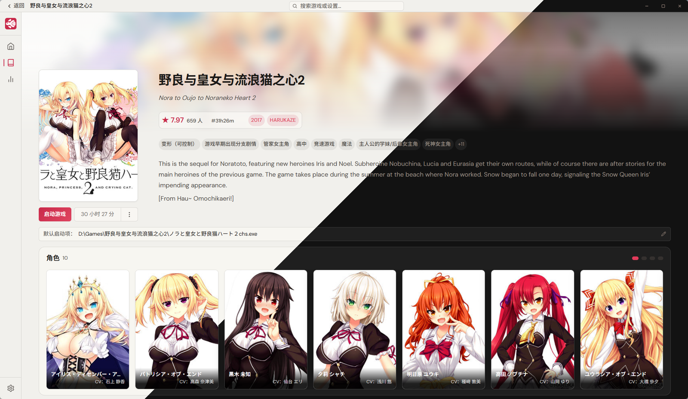
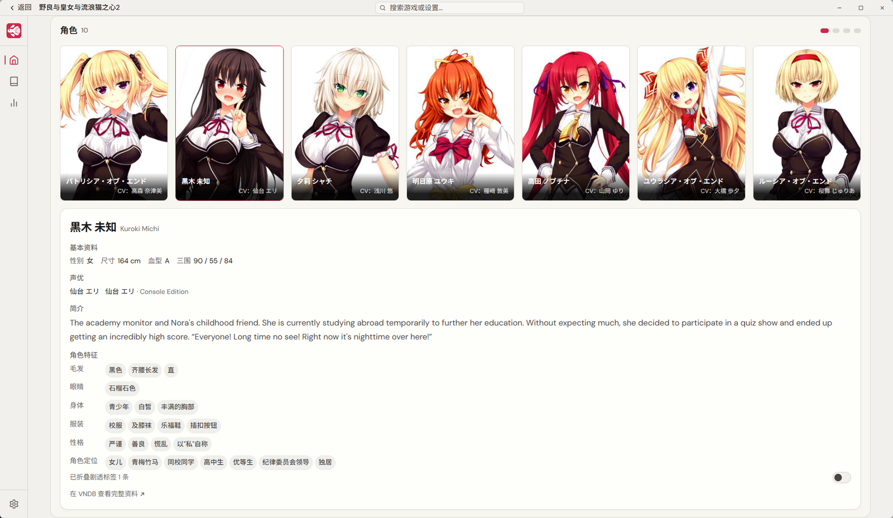

<p align="center">

</p>

<h1 align="center">FishVN</h1>

<div align="center">


</div>

<p align="center">
  
</p>
<p align="center"><sub>浅色 / 深色主题</sub></p>

## About

FishVN 是一个 **Windows 桌面应用**，用来管理本地安装（甚至未安装）的 Galgame：**导入、记录、启动、计时、回顾**。

库里游戏支持自定义修改数据：几乎全数据可编辑，包括角色。

<!-- 留给你写：为什么做、跟用过的工具哪里不一样 -->

> [!IMPORTANT]
> 仅支持 Windows 10 / 11。转区与缩放依赖 Locale Emulator 与 Magpie，需自行安装并在设置页填写路径。

## Features

- **添加**：手动添加、从启动文件添加、扫描目录批量识别。
- **启动项**：支持多游戏安装实例添加（原版/汉化版）；可单独设置转区、Magpie 超分缩放（ 全屏 / 窗口）、启动附加参数。
- **计时**：前景/存活双口径，可以精准记录窗口在前台的时间或者进程存活时间，设置可选统计口径。
- **VNDB 同步支持**：支持导入VNDB的愿望单、游玩中等状态游戏，双向可选同步。
- **标签**：标签与特征的中文译名取自 PotatoVN 的抽取表（上游为 VNDBTranslatorLib，MIT），另有自补；约 6000 条标签译名。可选成人向与剧透标签隐藏 + 个人偏好标签设置。
- **角色**：颗粒度到角色特征的角色系统，可自定义添加/修改角色数据。
- **统计**：基于结构化的标签，本地数据统计的游玩活跃度、时长排行、发行年代分布、题材词云等图表。
- **外观**：六色强调色 + 深浅主题支持。

<p align="center">
  
</p>

## Get started

从源码构建，需要 Node.js 22+ 与 Rust stable（MSVC 工具链）。

```bash
npm install
npm run dev      # 起开发窗口
npm run build    # 安装包输出到 src-tauri/target/release/bundle/nsis/
```

## Goal

该项目基于个人需求，所以可能不会满足所有人的需要。如果它有帮助到你，那就再好不过了。同类中有不少优秀的项目，我也大量参考借鉴了他们的实现，特此列出：

- [PotatoVN](https://github.com/GoldenPotato137/PotatoVN)
- [ReinaManager](https://github.com/huoshen80/ReinaManager)

### 计划外的功能

- 多源刮削（Bangumi、YmGal 等）
- 非 Windows 平台（macOS / Linux）
- 存档管理（备份、云同步）

## Tech stack

- 前端：Svelte 5、Vite、纯 CSS
- 后端与桌面：Tauri v2、Rust、rusqlite
- 数据源：VNDB API

## 致谢

[Tauri](https://tauri.app)、[VNDB](https://vndb.org)、[PotatoVN](https://github.com/GoldenPotato137/PotatoVN)、[VNDBTranslatorLib](https://greasyfork.org/scripts/445990)、[Locale Emulator](https://github.com/xupefei/Locale-Emulator)、[Magpie](https://github.com/Blinue/Magpie)、[Noto Sans SC](https://fonts.google.com/noto)。

<p align="center">
  <sub>ScarletFish</sub>
</p>
